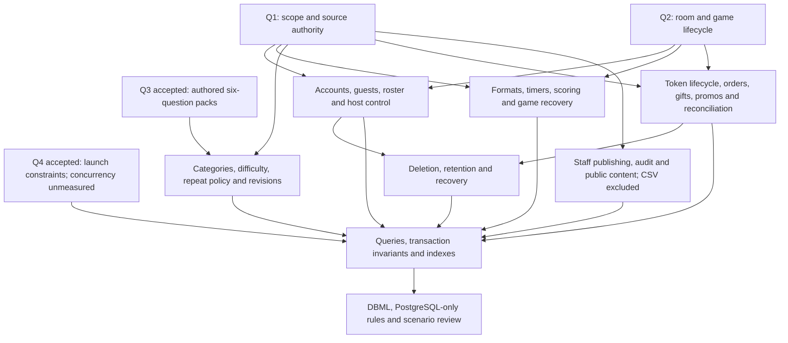

# Sahsah PostgreSQL design session

Started 2026-10-23; updated 2026-11-03. Product decisions Q1–Q94 are recorded, including corrections. The v1.2 design is ready for implementation review; production rollout is separate.

The user requested a PostgreSQL database design grounded in the prototype and the research in `../sahsah_designs`, with a DBML deliverable and explicit table, relationship, constraint and index planning. This is design work with disposable PostgreSQL validation. No application migration, provider operation or deployment has been performed.

## Working documents

- [Evidence and conflicts](requirements.md): what the code and project documents actually establish.
- [Domain glossary](../../CONTEXT.md): established vocabulary, separate from implementation decisions.
- [PostgreSQL and DBML reference](postgresql-notes.md): primary-source technical guidance; no measured performance claims.
- [Railway budget and capacity research](railway-capacity.md): current billing, hypothetical cost examples and staged load-test profiles for the actual launch constraints.
- [Single-instance capacity estimate](single-instance-capacity.md): a conditional 100-room initial target and 100–250-room working range under explicit resource/handler assumptions, separate from price-tier guarantees.
- [Pack freshness analysis](pack-freshness.md): comparison of the user's two ideas, exhaustion examples and accepted exposure/participation policies.
- [Editable packs and game history](content-editing.md): accepted editing, snapshot, replacement, roster and progress behavior, with proposed transaction boundaries.
- [Working DBML](sahsah.dbml): v1.2 contains 39 tables covering the agreed launch domains, including native billing. Load its PostgreSQL index and guard companions as well; see the executed validation and current status.
- [Completion audit](schema-status.md): explicit feature coverage and remaining work; structural validity must not be presented as a complete launch schema.
- [Commerce design](commerce-design.md) and [primary-source commerce research](commerce-research.md): accepted price/recipient/staff rules, source-backed funding and provider-contract findings/uncertainties.
- [Lifecycle transactions](lifecycle-transactions.md): fixed elapsed-hour expiry, fresh-clock checks, device control and atomic claim cleanup/restoration, with PostgreSQL sources.
- [Token accounting](token-accounting.md): accepted host charging, unopened-game restoration and one nonexpiring bank; provider verification/reconciliation remain design work, not customer cash-out.
- [Query and index plan](query-plan.md): named queries, transaction boundaries, current index choices and measured local access paths.
- [Gameplay state and scoring](gameplay-design.md): accepted timer, memory, reopening and scoring rules, with proposed runtime records and atomic writes.
- [Content and media](content-and-media.md): ten authorable formats, manual publishing, media roles/variants and retained asset references.
- [Identity and invitations](identity-invitations.md): Egypt WhatsApp/Firebase mapping, phone proofs, invitation registry, replay readiness and lock ordering.
- [Payment workflows](payment-workflows.md): merchant-scoped evidence, one settlement, limited free campaigns, late/extra payment exceptions and gift corrections.
- [Operations and retention](operations-and-retention.md): leased work, idempotency, staff/public/contact records, content purge and deletion; [supplementary SQL](postgresql-supplement.sql) and [guards](postgresql-guards.sql) complete PostgreSQL-specific integrity.
- [Scenario review](scenario-review.md): paper traces of accepted behavior and remaining enforcement boundaries; no runtime tests claimed.
- [Room/game ADR](../adr/0001-separate-rooms-and-games.md): accepted replay and history boundary. Further ADRs will record consequential decisions when they are made; research proposals are not accepted decisions.
- [Editable catalog ADR](../adr/0002-editable-packs-and-game-snapshots.md) and [group-freshness ADR](../adr/0003-group-freshness-and-player-roster.md): accepted content/history and participation boundaries.
- [Expiry/restoration ADR](../adr/0004-game-expiry-and-token-restoration.md): accepted terminal game rules and traceable token compensation.
- [Proposed grant ADR](../adr/0005-source-backed-token-grants.md): order/staff funding provenance, independently of repeated provider callbacks or multiple actual payments.
- [Unified bank ADR](../adr/0006-one-bank-without-customer-cashout.md): latest scope clarification; no customer cash-out, ordinary purchase-refund workflow, token-source spending priority or allocation tables.

## Confirmed instructions

- Design for PostgreSQL.
- Analyze the existing prototype and the supplied local research.
- Work through the design with the user rather than silently selecting product policies.
- Preserve the independently managed applications and existing prototype behavior.
- Keep financial tokens distinct from team points.
- Scope authority: user decisions first, final quotation for scope, current prototype for gameplay evidence with conflicts resolved individually.
- A reusable room contains separate games; replay preserves the old game's history and creates a new game.
- Categories contain authored question packs; each pack has a fixed set of six questions maintained through AdminJS.
- Initial catalog approximately 4,000 questions, about 70% with good-quality images; image bytes are stored in Cloudflare.
- At most six people per game **including the host**, corrected by the user on 2026-10-24. Capacity models use six connections per active game when each person has one device; they do not add a seventh host. Additional tabs/displays/reconnect overlaps remain a separate connection consideration.
- Initial deployment: one NestJS service and one PostgreSQL service on Railway; consider the $5 Hobby plan initially and $20 Pro plan as the project grows. These subscription amounts do not establish a fixed hardware capacity or a monthly bill cap.
- Launch concurrency is unknown and expected to grow gradually; the earlier 100-room/20-guest/100,000-question example is not an accepted workload.
- Prefer packs unseen by all signed-in starting players; ask the host to change category or explicitly accept repeats when fresh inventory is unavailable.
- Record question exposure on opening, separately from completion. Credit the fixed signed-in starting roster despite temporary disconnection, excluding players after explicit departure.
- One signed-in account has one active game. Explicit guest departure releases that account's claim and stops future credit; temporary network loss does neither.
- Signing in after start does not attach an account to the current guest seat; account-based freshness/progress starts next game.
- Public pack editing is allowed after warning/confirmation. Existing games retain starting content; new games use the edited catalog.
- Ordinary edits preserve question identity/history; replacement creates a new question identity in the same pack slot. Earlier completion remains visible and the current pack is marked Updated.
- Completion requires six resolutions in one game, including no-winner results. Same-game resume preserves progress; partial attempts from different games do not combine.
- Host deliberate departure or End game finalizes for everyone. Temporary disconnection/app closure remains resumable until 24 elapsed hours without meaningful host gameplay activity; expiry releases remaining active-account claims.
- The same host can explicitly take over on another device; only one controlling credential is current, and switching/resume does not charge again.
- The signed-in host pays one token for the full game; guests are free. Accepted start, snapshots/roster, claims and debit are atomic; a rejected start charges nothing.
- Ending/expiry automatically restores the original token only when no question ever opened. After opening, ordinary ending/inactivity retains the charge.
- Recover platform-interrupted games first; staff can restore once for a verified unrecoverable failure with a reason and original-debit linkage.
- All granted token types are nonexpiring. Unclaimed-gift windows remain separate; customer cash-out/refund workflows and promotional-token expiry are excluded by later clarification.
- Keep 1/2/5 presets and custom whole-token purchases from 1 through **20**, replacing the prototype's 999 cap in the production design. Prices are server-calculated and frozen on orders.
- Paid gifts are bound to a verified recipient phone; credit an existing matching account after payment or allow claim after verified registration. The sender receives no token credit for the gift.
- Apply one effective gift/promo discount, choosing the larger eligible value without stacking; purchased token quantity does not change.
- A designated privileged staff role may grant nonexpiring complimentary tokens with a required reason and audit, through ledger credits rather than balance overwrite.
- Base price is **100 EGP per token**, with editable quantity tiers applied equally to presets and custom quantities. Apply the quantity discount first, then one better eligible gift/promo discount. Actual tier thresholds/percentages are configuration still to be supplied.
- Block a gift to the buyer's own account or verified phone. Bind an existing verified recipient account at checkout; otherwise bind once on the first verified claim. Subsequent phone changes/payment retries cannot reroute a bound gift.
- Promo codes have configurable validity windows and optional global redemption caps; default one successful use per purchasing account, including when that buyer purchases a gift. Q42 defines reservation/release behavior.
- Staff use separate email-based identities and roles from players' WhatsApp/Firebase accounts. A staff member may separately hold a player account.
- Latest Q89 roles: Admin manages content/prices/promotions/grants/support/financial actions; Super Admin additionally manages staff accounts/roles. Earlier Q40 Content Admin restriction is superseded.
- Valid discounts may reach 100%, creating a zero-cost order that skips Paymob and fulfills once. No discount may exceed 100% and no monetary total may be negative.
- Limited promo capacity is reserved at checkout, consumed on accepted payment/free settlement and released only when the payment path is confirmed closed unpaid; unknown outcomes require reconciliation.
- The current product has no customer cash-refund/cash-out feature: credits remain in one bank until spent. The ordinary source-based cash-refund/valuation discussion in Q43/Q48 is superseded; do not implement source-lot accounting, reserved wallet credits or spending priority for it.
- Actual external payment reversals still require internal financial records and Super Admin reconciliation, without negative wallets or automatic account restriction. Any exceptional bank/staff money action is separate from a customer refund feature and needs its own accepted integration rules.
- All token sources join one visible bank and none expire, including promotional tokens. Q45a closes the source-spending attribution branch instead of selecting FIFO/free-first.
- Each promo code targets an exact fixed 1/2/5 bundle and must have an end date. Matching quantity qualifies through the custom counter or preset; other quantities do not.
- Overall score corrections preserve question awards/category results; terminal games have locked scores. A zero answering clock does not automatically reveal or resolve a question.
- Two scoring teams exist without a minimum connected membership. Guests choose a side before start; the host may be neutral. Team assignments freeze at start.
- The 36th resolution automatically finishes and locks the game, with no final-review phase. Corrections must precede that resolution.
- Each question owns its format; packs may mix formats. Arabic is required; missing optional Franco-Arabic fields fall back to Arabic.
- Incomplete packs may be saved as drafts. Playable packs require six valid questions and ready required media; public updates save a valid set atomically after warning/confirmation, without a reviewer approval gate.

## Round 1: foundational decisions

Answered by the user. Q3 changed the initial question-selection recommendation; Q4 replaced the illustrative workload with actual launch constraints.

| ID | Decision | Accepted answer | Unblocks |
| --- | --- | --- | --- |
| Q1 | Authority when prototype, quotation and research conflict | User decisions override documents; quotation is the working scope baseline; prototype informs mechanics | Launch scope, providers, formats, identity and commercial model |
| Q2 | Invitation room versus individual game and replay | Reuse an invitation room; create a separate game for each replay | Room/game/team ownership, history, token-consumption identity, invitation lifecycle |
| Q3 | Fixed authored boards versus selection from a published question bank | AdminJS-managed categories contain many fixed six-question packs; user-visible completed/remaining packs | Pack authoring, pack selection, progress ownership, completion rules, revision behavior |
| Q4 | Workload to design and validate | One NestJS service + one PostgreSQL on Railway $5/$20 plan; at most six people including host; about 4,000 questions, 70% illustrated via Cloudflare; no concurrency estimate | Railway cost research and a conditional single-instance capacity model; no measured concurrency limit yet |

No response is inferred from elapsed time or the preselected UI choices.

## Round 2: pack composition and progress

Q5, Q6, Q8 and Q9 were answered on 2026-10-24. Q7 was explored here and then resolved in round 3 in favor of group-aware selection.

| ID | Decision | Answer / status | Unblocks |
| --- | --- | --- | --- |
| Q5 | How category packs form a board and who chooses them | Accepted: one fixed six-question pack from each of six categories; show progress, default to an unplayed pack and permit host selection | Game-to-pack relationship and board assembly |
| Q6 | Whether packs are separately purchased/unlocked | Accepted: all published packs are included through game tokens; no separate pack sale/unlock at launch | No additional commercial pack-entitlement model needed |
| Q7 | Whose completion/remaining progress matters | Resolved in round 3: consider all tracked signed-in participants; host-only progress and per-user content remapping were not selected | Progress/exposure subject, group selection and availability |
| Q8 | Completion boundary | Accepted: all six questions resolved, including no-winner resolutions; distinguish unplayed/in-progress/completed | Progress computation; personal presence/credit and partial-pack continuation still need rules |
| Q9 | Reusing one logical question across packs | Accepted: pack owns six question records; staff manually review duplicates. No automatic duplicate warnings or semantic uniqueness requirement at launch | One pack per question record; repeated text in separately created records remains possible |

The user reconfirmed manual AdminJS authoring of packs with their six questions and image/audio content. Do not add text/hash uniqueness or a duplicate-detector feature. Question format/media structure and publication behavior remain design decisions.

## Round 3: freshness, participation and publication

All four answered. The user accepted Q7/Q10/Q11 recommendations and specified freely editable public packs for Q12 instead of the proposed publication freeze.

| ID | Decision | Accepted answer | Unblocks |
| --- | --- | --- | --- |
| Q7 | Group freshness and exhausted inventory | Prefer a wholly unseen authored pack for all tracked signed-in players; host explicitly chooses another category or accepts repeats | Selection, fallback and group-account progress |
| Q10 | What counts as exposure | Question opened/released to tracked participants, separately from all-six completion | Eligibility history and partial-game behavior |
| Q11 | Late joining | Freeze the playing roster at start; original participants reconnect; new players enter the next game | Tracked group and admission/recovery rules |
| Q12 | Published edits | Staff may edit a published pack after a warning and confirmation; no immutable-publication gate or new-pack requirement | Historical content preservation and replacement semantics |

## Round 4: effects of edits and player identity

All four recommendations accepted through asynchronous answers.

| ID | Decision | Accepted answer |
| --- | --- | --- |
| Q13 | Public edit during an existing game | Existing games retain starting content; new games use the edited pack |
| Q14 | Edit versus replacement | Edits preserve logical identity/history; explicit replacement creates a new question ID in the same pack |
| Q15 | Simultaneous signed-in participation | One active game per account; original game can be resumed/reconnected |
| Q16 | Progress during network loss | Credit the signed-in starting roster despite temporary disconnects |

## Round 5: updated packs and ending participation

All four recommendations accepted through asynchronous answers.

| ID | Decision | Accepted answer |
| --- | --- | --- |
| Q17 | Progress after a question replacement | Preserve historical completion and flag the current pack Updated; new questions are not automatically seen/completed |
| Q18 | Explicit guest departure | End participation, release the account's active-game claim, retain prior history and stop future credit; do not replace the historical seat |
| Q19 | Anonymous player signs in after start | Current game keeps guest identity; account freshness/progress begins next game; no backfill |
| Q20 | Partial resolutions across games | Require all six resolutions in the same game; resume continues that game; new games do not combine partial attempts |

## Round 6: lifecycle and host control

All four recommendations accepted on 2026-10-26.

| ID | Decision | Accepted answer |
| --- | --- | --- |
| Q21 | Host explicitly leaves | End the game for all; a temporary disconnect remains resumable; defer transfer to another player at launch |
| Q22 | Idle game expiry | Expire after 24 hours without meaningful host gameplay activity, release active-account claims and preserve history; Q26 later defines unopened-game token restoration |
| Q23 | Early End game versus returning later | End game finalizes that game; closing the app preserves same-game resume before expiry; incomplete packs remain incomplete |
| Q24 | Same host switches device | Allow explicit controller takeover by the same account; one controller at a time; old controller loses action authority |

## Round 7: payer and token restoration

All four answered on 2026-10-26. Q26 selected unopened-game restoration rather than retaining every accepted-start charge.

| ID | Decision | Accepted answer |
| --- | --- | --- |
| Q25 | Who funds a game | Host pays one token for everyone; lobby/reconnect/same-game resume/device switch are free |
| Q26 | Voluntary ending or idle expiry | Restore one token if no question ever opened; otherwise keep the charge. Rejected starts charge nothing |
| Q27 | Platform interruption | Recover first; staff may restore one token once for a verified unrecoverable failure, with reason and original-debit reference |
| Q28 | Paid token expiry | Purchased and paid-gift credits do not expire |

## Round 8: shop, gifts and controlled credits

All four answered. The user changed the proposed custom limit from 999 to 20 and accepted Q30–Q32 recommendations.

| ID | Decision | Accepted answer |
| --- | --- | --- |
| Q29 | Preset/custom quantities | Keep 1/2/5 presets plus custom whole quantities **1–20**; prices server-controlled and frozen on orders |
| Q30 | Gift claim identity | Bind paid gifts to verified recipient phone; credit existing matching accounts or claim after verification on registration; never credit sender |
| Q31 | Discount stacking | One effective discount per order, selecting the better eligible gift/promo discount; no stacking; freeze applied amounts |
| Q32 | Complimentary staff credits | Permit only a designated privileged staff role, with required reason and audit, via ledger entries rather than balance overwrite |

## Round 9: base pricing, promo limits and staff identity

All four answered. The user replaced the flat-price proposal with 100 EGP per token and editable bundle discounts.

| ID | Decision | Accepted answer |
| --- | --- | --- |
| Q33 | Base/token and bundle pricing | Base 100 EGP per token; bundle discounts editable in AdminJS; order prices remain frozen |
| Q34 | Self-gifting | Block recipient matching buyer account or verified phone |
| Q35 | Promo limits | Configurable dates/global cap; default one successful use per buyer; gifted-order usage belongs to buyer |
| Q36 | Staff identity | Separate staff login/roles from player accounts; no implicit financial authority for player identities |

## Round 10: quantity pricing, gift binding and staff roles

All four recommendations accepted through asynchronous replies.

| ID | Decision | Accepted answer |
| --- | --- | --- |
| Q37 | Custom versus preset discounts | Same quantity always has the same price; editable quantity thresholds apply to both |
| Q38 | Quantity versus gift/promo layering | Quantity discount first, then the one winning eligible gift/promo discount |
| Q39 | Recipient binding time | Bind a matching verified account at checkout; otherwise bind once on first verified claim; do not reroute on retries |
| Q40 | Historical staff-role answer | Superseded by Q89: operational Admin; Super Admin additionally manages staff accounts/roles |

## Round 11: free totals, promo admission and monetary reversals

All four answered; Q41 allows zero-cost orders rather than requiring positive checkout totals.

| ID | Decision | Accepted answer |
| --- | --- | --- |
| Q41 | Zero-total discounted orders | Allow 100% configured/code discounts, skip Paymob and fulfill once for marketing; never exceed 100% or go negative |
| Q42 | Limited promo availability while paying | Reserve at checkout; consume on verified payment; release only after confirming the payment path closed unpaid; reconcile unknown outcomes |
| Q43 | Ordinary cash-refund eligibility | Initially discussed/accepted, then superseded by Q45a scope clarification: no customer cash-refund/cash-out feature or ordinary allocation workflow |
| Q44 | External reversal after spending | Preserve confirmed provider reversal/shortfall for Super Admin reconciliation; no negative wallet or automatic restriction. Do not infer source-lot spending from this exception |

## Round 12: source accounting, bundle codes and refund valuation

| ID | Decision | Answer / status |
| --- | --- | --- |
| Q45 | Mixed token sources | One combined nonexpiring bank; Q45a clarifies no cash-out/refund feature, closing ordinary refund-attribution decisions |
| Q46 | Welcome code quantity | Code targets one exact fixed bundle and has an end date; Q46a accepts matching quantity from either selector |
| Q47 | Promotional credit expiry | Granted promotional tokens do not expire; code expiry does not reclaim granted tokens |
| Q48 | Partial cash-refund valuation | Initially accepted, then superseded for current product by Q45a no-refund clarification; do not build ordinary proportional refund/reservation machinery |

Q45a clarified current scope: the player cannot refund/cash out tokens; one permanent bank is spent on games. Remove the proposed source balances/allocations and refund-reserved wallet column. Retain source order/grant/ledger evidence for funding, history and exceptional reconciliation. Q46a accepted matching fixed-bundle quantity through either selector. Both clarifications are closed.

## Round 13: gameplay rules

All four recommendations accepted.

| ID | Decision | Accepted answer |
| --- | --- | --- |
| Q49 | Question timer starts automatically or manually | Preserve current automatic 60-second timer with host pause/reset |
| Q50 | Audio replay allowance | Preserve unlimited replay controlled by the host; ordinary sound-question count is not a token spend |
| Q51 | Memory image viewing | Preserve manual show/hide/revisit with no viewing countdown; answer-timer interaction follows Q49 |
| Q52 | Scoring after staged hints | Default to current stage points but permit host override up to original tile points; retain correction audit |

## Round 14: memory timing, reopening and corrections

All three recommendations accepted through asynchronous replies.

| ID | Decision | Accepted answer |
| --- | --- | --- |
| Q53 | Memory answering-clock trigger | Start on the first hide; later revisits do not restart it; explicit host pause/reset remains available |
| Q54 | Return before resolution | Allow return to the board, preserving hints/reveal/memory progress and pausing remaining time until reopening; this deliberately changes the prototype's reset behavior |
| Q55 | Manual team-score correction | Enter a nonnegative new total and record its difference from the prior total as an audited adjustment; preserve earlier awards |

## Round 15: resolution and final-result boundaries

All four recommendations accepted by the user.

| ID | Decision | Accepted answer |
| --- | --- | --- |
| Q56 | Scope of manual corrections | Overall total only; preserve question awards and category results calculated from those awards |
| Q57 | Corrections after ending | Lock scores when the game ends; corrections are available while active |
| Q58 | Clock reaches zero | Host still reveals/resolves; no automatic reveal, award or no-winner resolution |
| Q59 | Team membership prerequisites | No minimum connected membership per side; guests choose teams in the lobby, host may be neutral; freeze assignments at start |

## Round 16: completing games and authoring playable content

All four answered. Q60 selects the prototype's automatic finish instead of the proposed review step.

| ID | Decision | Accepted answer |
| --- | --- | --- |
| Q60 | Finish after the last question | Finish and lock scores automatically on the 36th resolution; no final-review phase |
| Q61 | Format ownership | Each question owns its format; mixed-format packs are allowed; categories remain selectable groupings |
| Q62 | Required languages | Arabic required; optional Franco-Arabic fields fall back to Arabic when absent |
| Q63 | Drafts and playable completeness | Incomplete drafts allowed; publishing/playable updates require all six valid questions and ready required media, saved atomically without a reviewer approval gate |

## Round 17: formats, media and archival

All four recommendations accepted.

| ID | Decision | Accepted answer |
| --- | --- | --- |
| Q64 | Authorable launch formats | All ten prototype formats, represented as actual question formats rather than demo category overlays |
| Q65 | Blur/zoom hint stages | Three editable positive strictly decreasing values starting at original tile value; defaults 600→400→200, 400→250→150, 200→150→50 |
| Q66 | Optional images | Ordinary questions may have an image; suitable questions may have an answer-only image released at reveal |
| Q67 | Withdrawal | Archive/hide categories or packs from new games while preserving existing games/progress; category archival does not rewrite pack status, and restoration makes its published packs visible again |

## Round 18: invitations and recovery

All four recommendations accepted.

| ID | Decision | Accepted answer |
| --- | --- | --- |
| Q68 | Invitation shape | Six random digits including leading zeros, plus QR/share links; unique while usable, distinct from private reconnect credentials |
| Q69 | Invitation lifetime | 24 hours from issue; host may rotate; replay keeps a valid code or gets a fresh one. Expiry stops new admission, not ongoing play or original-player recovery |
| Q70 | Lobby admission | Immediate join with name/team and available capacity, no anonymous OTP; host may remove before start; no approval queue |
| Q71 | Guest recovery | Persist a private same-client credential; reconnect reuses the seat. Lost anonymous credentials/new device cannot reclaim by name/code; signed-in players recover after authentication |

## Round 19: profiles, phone changes, replay and deletion

All four answered. Q72 restricts launch phone numbers to Egypt instead of the proposed international scope.

| ID | Decision | Accepted answer |
| --- | --- | --- |
| Q72 | Minimal profile / phone scope | Display name, verified WhatsApp phone and Arabic/Franco preference; Egypt phone numbers only; no required player email/DOB/gender/avatar |
| Q73 | Phone change | Verify both old and new numbers, preserve account/bank/history/bound gifts, reject an already-owned new number and never merge; lost-old-number recovery goes through support |
| Q74 | Replay roster | Return to lobby retaining names/team choices; each non-host confirms Ready for each game; host may remove absent players; freeze the confirmed roster and charge once at successful start |
| Q75 | Delete with a token balance | First leave/end active play, then explicitly confirm forfeiting the remaining bank without cash refund; profile deletion/anonymization and retained transaction evidence follow the agreed retention policy |

## Round 20: gift corrections and exceptional settlement

All four recommendations accepted.

| ID | Decision | Accepted answer |
| --- | --- | --- |
| Q76 | Unclaimed gifts | No expiry. Super Admin may correct only an unbound/unclaimed phone after verified buyer request plus audit; once bound, account ownership remains stable |
| Q77 | Automatic free campaigns | Exact fixed bundle, mandatory end date, default one accepted free order per buyer and optional global cap; AdminJS may raise buyer allowance |
| Q78 | Multiple real payments for one order | Record all payments, grant tokens once and open a staff reconciliation case for extras; no automatic extra grant/customer refund feature |
| Q79 | Late matching payment | Honor original amount/currency/quantity once after verification, even after local closure; flag released-promo/closed-order exceptions. Wrong amounts/currency or deleted beneficiary go to reconciliation |

## Round 21: feedback, contact, import and history retention

All four answered. Q82 explicitly removes CSV from launch scope, superseding the quotation.

| ID | Decision | Answer / status |
| --- | --- | --- |
| Q80 | Question feedback | Accepted: host-only editable Like/Dislike per copied question/game after reveal, including retained history; no rewards/comment requirement; score locking does not block feedback |
| Q81 | Contact forms | Accepted: persistent Super Admin inbox for Support, Experience and Business/Influencer submissions, including optional experience rating/comment; open/closed state, no email/ticketing integration |
| Q82 | CSV import | Explicitly excluded: staff create each question and its image/media individually through AdminJS; no CSV imports, templates, jobs or row-error tables |
| Q83 | Full game content retention | Accepted: 12 months of full copied content, retaining compact results/original question identities/account progress afterward; current catalog and token expiry are unaffected |

## Round 22: final policy boundaries

Initially pending; all four recommendations were explicitly accepted on 2026-11-03 (Round 25).

| ID | Decision | Accepted answer, 2026-11-03 |
| --- | --- | --- |
| Q84 | Removed member rejoin | Block the known account until host lifts removal; revoke old membership/credential, use invitation rotation for the shared locator; no active-game kicking |
| Q85 | Feedback after content purge | Preserve compact votes/source identity but close new/edited votes when the exact game content is purged; no separate permanent copy |
| Q86 | Deletion with unresolved funding | Resolve/review pending funding, then reconfirm exact forfeiture; block new funding/binding during deletion, preserve gifts for other recipients |
| Q87 | Same-phone account recreation | Campaign-scoped keyed phone fingerprint prevents resetting a free allowance until campaign end; never restore forfeited bank/history or identify humans across different phones |

Later commerce/integration decisions still include automatic 100% campaign eligibility/quotas, gift claims/corrections, late payment exceptions and actual provider reversal handling. They do not reopen customer cash-out.

## Round 23: simplify physical storage without removing features

Accepted on 2026-11-02. The user asked whether the 61-table draft was too complex, authorized proposing feature deferrals, then selected **“Retain all features: about 37 tables.”** The user also explicitly requested simple staff administration and documentation of every decision.

- Consolidate the physical model using the [37-table mapping](schema-simplification-review.md); preserve every previously accepted product feature.
- Keep the page/branding CMS, self-service phone changes and automatic free campaigns. Proposed deferrals were not selected.
- Staff administration uses staff accounts with two fixed roles, persistent sessions and one audit log.
- Durable game, token, promotion and payment decisions stay in PostgreSQL. Local cache/presence is rebuildable; no cache deployment was requested or installed.
- Some cross-record guarantees become explicit transactional service checks. Core source uniqueness, nonnegative balances and retained media/progress references remain represented.
- At this checkpoint Q84–Q87 remained pending; they were later explicitly accepted in Round 25.

See [ADR 0007](../adr/0007-consolidate-launch-schema.md). The older validation checkpoint below describes the expanded v0.9 model; the new model needs its own structural check.

## Round 24: native billing and regular-admin correction

Accepted on 2026-11-02. These answers supersede the quotation's native-billing exclusion and the earlier Q40 permission split.

| ID | Accepted decision |
| --- | --- |
| Q88 | Apple In-App Purchase / Google Play Billing for native purchases; Paymob remains website checkout. Wallet names are not substitutes for native billing. |
| Q89 | Regular Admin manages all operational content/pricing/promos/grants/support/financial actions. Super Admin additionally manages staff accounts/roles; replace content_admin with admin. |
| Q90 | Latest correction: fixed native 1/2/5 bundles. The initial all-quantities answer is superseded; web counter stays 1–20. |
| Q91 | Latest correction: personal native purchases. Native gifting/offer authoring is deferred; gift purchases/promo checkout stay on web and credits share one bank. |
| Q92 | Aim to match web EGP prices where store pricing permits; verified store price/currency is authoritative, with no automatic override by AdminJS pricing. |
| Q93 | Native store-offer limits are separate from web promo-code limits; relevant if native offers are later introduced. |
| Q94 | A purchase without a prior account/order link may bind once to the first authenticated verified claimant's own bank. Already-linked purchases keep their owner/order. |

See [ADR 0008](../adr/0008-regular-admin-operational-access.md), [ADR 0009](../adr/0009-native-store-purchases.md) and the [scope review](payment-and-staff-scope-review.md). Q89 supersedes older operational Super-Admin-only wording; staff management remains exclusive. Q84–Q87 were later accepted in Round 25.

## Native v1.1 validation checkpoint

Static export/type/key checks: 39 tables, 37 enums, 84 FKs and 262 named checks; 142 DBML index structures plus eight supplementary partial indexes. Two new records cover native SKU mapping and verified purchase/completion; existing order/evidence/ledger structures are reused. The latest Q90/Q91 simplification is the effective scope. Runtime billing/SQL/concurrency/load verification is not claimed. The current guide covers all 39 tables.

## Consolidated v1.0 validation checkpoint

Validated on 2026-11-02 with pinned `@dbml/cli@10.3.1`: 37 tables, 35 enums, 73 FKs and 233 named checks. The SQL has 37 PKs, 29 explicit unique indexes, 41 nonunique indexes and 20 inline unique constraints: 127 index structures, plus seven supplementary partial indexes. Every FK target has matching arity/types and PK/UNIQUE support. The approved mapping covers all 61 original tables. This is static validation; SQL execution, concurrency behavior, query plans and load tests remain unclaimed. The [expanded DBML](archive/sahsah-v0.9-expanded.dbml) is retained for comparison.

## Expanded v0.9 validation checkpoint

Checkpoint v0.9 validated on 2026-10-27 using Node 24 and pinned `@dbml/cli@10.3.1`, outside application directories. It exports 61 tables, 34 enums, 109 FKs, 229 named checks, 61 PKs, 37 additional unique indexes, 41 nonunique indexes and 29 inline UNIQUE constraints: 168 expected index structures. The three supplemental partial indexes are additional. Every FK target has matching PK/UNIQUE support, arity and types. Combined campaign/zero-order checks, typed payment sources, optional proof pairs, deletion-forfeiture discrimination and retention markers were statically inspected. Generic staff-audit target keys support UUID/singleton/composite keys. The closure FK proves same-attempt linkage but not `confirms_closed_unpaid = true`; processing must check semantic proof eligibility. Exactly-six, conservation, authority and purge completion also remain controlled transaction invariants. No SQL was executed, and no application dependencies/lockfiles changed.

Export is a syntax check, not proof of complete gameplay constraints. The CLI emits foreign keys as `DEFERRABLE INITIALLY IMMEDIATE` and does not preserve the draft composite primary-key label; final migrations must deliberately specify the required behavior. Exactly six pack questions and six game categories still require publication/start transaction validation.

## Decision tree

The next round is recomputed from the answers. This tree is an agenda, not a requirement to implement every candidate mechanism.

## Coverage checklist

| Area | Decisions to settle | Candidate records to evaluate, not an approved table list |
| --- | --- | --- |
| Identity | Account owner; Firebase mapping; verified phone changes; guest reconnect identity; roster versus device; host takeover | Accounts, external identities, phone verification challenges, guest grants, memberships, staff identities |
| Invitations | Room lifetime; code uniqueness/reuse; guest capacity; join locking; removal; replay behavior | Rooms, invitation codes/grants, room memberships |
| Gameplay | Two teams; team membership; early finish; expiry; reconnect; allowed state transitions | Games, game teams, game memberships, board categories, board slots, question runtime state |
| Scoring | Stage cap or host override; no winner; correction/undo; negative totals; corrections after completion | Question resolutions, score adjustments, derived score totals |
| Content | Packs within categories; pack selection; progress owner; completion; question reuse; topic versus format; publication/revisions; exposure and exhaustion | Categories, question packs, pack membership/slots, questions, revisions, translations, stages, progress/exposures |
| Media | Reuse; originals and derivatives; reveal access; import references; failed processing; takedown | Media assets, derivatives, question-media associations, processing/upload records |
| Economy | One permanent bank; atomic game debit/restoration; duplicate protection; no ordinary cash-out/source allocation | Wallets, token ledger, source grants and game consumption |
| Commerce | Fixed bundle targets; immutable prices; paid/free settlement; attempts versus actual transactions; duplicate/late callbacks; overpayment/reversals | Shop settings/tiers, bundles, orders, attempts, actual transactions, inbox and reconciliation |
| Gifts/promos | Recipient proof/binding; redemption; self-gifts; unclaimed windows/corrections; reversed-payment evidence; exact bundle scope; caps | Gifts, promotion rules, holds and consumed uses |
| Feedback | Host-only question feedback; subject and revision; uniqueness; edits; moderation | Feedback and any required moderation history |
| Staff/public content | Roles, publication validation, branding, public pages/contact and feedback; CSV explicitly excluded | Staff roles/sessions/audit, public content/media/settings, contact inbox and question feedback |
| Delivery/retries | Accepted command dedupe; persisted state; fan-out after commit; cross-instance behavior | Command results, delivery outbox/inbox, room events only where recovery semantics justify them |
| Operations | Deletion versus retained finance; retention by data class; backups; restore; cleanup | Policy-driven lifecycle fields and cleanup access paths; partitioning only if justified |

Every retained table must have a defined purpose, owner, key, nullability, relationships, lifecycle, deletion behavior and named access paths. Every proposed index must protect an invariant or serve a named query. Data already owned by Firebase/R2 is referenced deliberately rather than duplicated by default.

## Initial query inventory

| Query or command | Evidence / policy needed before physical design |
| --- | --- |
| Resolve an active invitation code | Code lifetime/reuse and whether codes belong to rooms or games |
| Recover the permitted current game state | Room/game model, participant identity and reveal authorization |
| List an account's resumable and completed games | Ownership, status definitions, pagination and retention |
| List a category's packs with completed/remaining progress | Progress subject, completion boundary, unpublished/retired visibility and pagination |
| Build a complete eligible 36-question board from fixed packs | One pack per category, point bands, pack choice, partial/repeat scope, exhaustion and fairness |
| Load a board's frozen question content | Revision/snapshot approach and locale behavior |
| Accept a host command once | Controller identity, expected state/version, retry identity and accepted transitions |
| Start a game and consume one token | Accepted-start boundary, nonnegative spending and retry behavior |
| Resolve a question and update scores | Once-only adjudication, corrections and derived-score rules |
| Fulfill a verified paid or valid zero-cost order | Actual provider evidence or local zero acceptance; source identity; overpayment/reversal reconciliation |
| Redeem a gift or reserve a limited promotion | Recipient/eligibility rules and race behavior |
| List orders and token movements | Account identity, financial retention and deterministic cursor ordering |
| Retry failed delivery or reconcile unknown payment outcomes | Whether persisted delivery records are required, retry states and scheduling |
| Search/administer/publish question content | Actual filters, ordering, review workflow, locale and content lifecycle |
| Expire rooms and clean retained operational records | Retention windows and safe deletion constraints |

## Required scenario review

Before calling the schema ready, trace at least these scenarios through its constraints and transaction rules:

1. The same start request arrives twice while two devices try to spend the last token.
2. An accepted score command is retried after the host loses its response.
3. Replay preserves the completed result and spends exactly one new token, under the selected room/game model.
4. A question is republished, retired or urgently withdrawn while a game uses its previous content.
5. Two games start together after a host has nearly exhausted an eligible question pool.
6. A guest refreshes, changes devices or loses its guest credential.
7. A delayed payment notification follows a failed-looking browser redirect; another notification is duplicated.
8. Two distinct provider transactions pay one order; a later refund references an original transaction.
9. A gift is claimed concurrently or a confirmed external reversal needs staff reconciliation after earlier token use; preserve one bank, with no customer payout/lot allocation.
10. An account is deleted while financial records and completed-game history have different retention requirements.

Only scenarios applicable to accepted scope become implementation requirements. The final design needs more than a valid diagram: PostgreSQL DDL for anything the chosen DBML exporter cannot express, a query/index rationale, transaction invariants and explicit unresolved limitations.

## Round 25: close policy boundaries and improve quality

Accepted 2026-11-03: the user selected **all four Q84–Q87 recommendations**. Known removed accounts stay blocked until host unblock; votes remain but close after content purge; deletion requires fresh funding review and exact bank confirmation; campaign-local keyed phone markers survive account recreation until campaign end.

Under the user’s instruction to improve design quality, v1.2 adds the refinements in [the quality review](design-quality-review.md) and [ADR 0010](../adr/0010-ledger-projection-and-postgresql-integrity.md), without adding tables or staff roles. The bank is projected only by ledger INSERTs. Frozen order digests, typed evidence, source eligibility, settlement/credit atomicity, immutable history, safe deletion/redaction and sparse indexes now have executable SQL. Global proof-hash uniqueness was removed because an identical financial state may legitimately recur.

DBML export plus both companions loaded successfully on PostgreSQL 18.6: 39 tables, 37 enums, 87 FKs, 304 CHECKs, 148 indexes including 19 partial indexes. The [reproducible suite](validation/README.md) records positive/rejection tests, separate-connection races and synthetic query plans in [latest-results.json](validation/latest-results.json). Application/provider/deployment validation remains future implementation work. Earlier “no SQL execution” checkpoints above remain historical.

## Handoff to database implementation, 2026-11-04

The user requested a prompt documenting the complete conversation context, final application decisions and exact stopping point so another model can implement the database schema. The [implementation prompt](implementation-prompt.md) consolidates all Q1–Q94 decisions plus Q45a/Q46a, subsequent scope corrections, the 39-table inventory, three required schema inputs, 68 executed reference checks/six concurrency cases, repository constraints and concrete implementation/acceptance steps. No new product policy or ORM was selected by preparing this handoff, and no backend/database implementation was performed in this documentation step.
