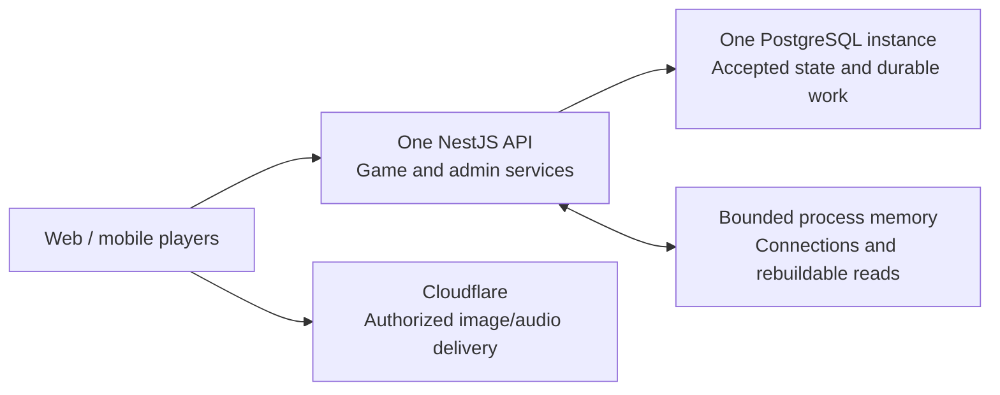

**Sahsah: simpler launch schema and cache review**

Reviewed: 2026-11-02. This is a proposal prompted by the user's concern about the 61-table draft. The user authorized proposing feature deferrals and asked to avoid overengineering staff administration. The user subsequently selected **retain all features: about 37 tables**. The [current DBML](sahsah.dbml) implements that consolidation; the [expanded original](archive/sahsah-v0.9-expanded.dbml) is historical. Previously accepted product rules remain unchanged. See [decisions-summary.md](decisions-summary.md).

My recommendation is one NestJS service, one PostgreSQL database, bounded process memory for disposable/cache data, and Cloudflare for files. Use a smaller relational model with a few strictly structured JSONB fields. The mapping below consolidates all 61 existing tables into a **37-table candidate**. Deferring the public-page CMS and self-service phone changes would remove four more, giving a **33-table launch candidate**. The 37-table choice is now represented in DBML and statically export-checked; the 33-table deferral option was not selected. Neither count establishes an executed migration or performance result. Do not reject an otherwise useful extra table merely to meet the count.

The earlier draft separated many one-to-one records and operational facts that can reasonably share a row in this application. That separation buys explicit relationships and independent lifecycles, but adds implementation and review work. It is more elaborate than I recommend as the starting point for the declared small deployment.

Table count alone does not predict latency, capacity or cost. The important work is controlling queries and writes per action, data volume, indexes, transaction duration and background processing. Combining tables can reduce joins and code paths; it can also weaken declarative guarantees or increase row contention. This review claims a simpler model, not a measured speedup.

The storage boundary:

| Data | Authoritative storage | Cache/process-memory role |
| --- | --- | --- |
| WebSocket objects, room-to-socket mappings, current connection presence | Process memory; clients re-establish connections after restart | Disposable; not evidence that a player explicitly left |
| Visible countdown animation | Client calculation from a persisted server deadline | No per-second database write |
| Categories, pack summaries and public labels | PostgreSQL | Bounded read cache; invalidate after catalog commits; revalidate playable content at game start |
| Question content and format configuration | PostgreSQL; private files in Cloudflare | Optional private internal cache by question/pack revision; authorize the delivered projection |
| Accepted game state, timer deadlines, resolutions and score changes | PostgreSQL | Optional versioned authorized read projection; all mutations use authoritative transactions |
| Seen-question history and pack completions | PostgreSQL | Optional display summaries; freshness/completion decisions use durable state |
| Available token balance, ledger and order fulfillment | PostgreSQL | A cached display balance cannot authorize spending or granting |
| Promotion limits and reservations | PostgreSQL | A cached counter cannot authorize free tokens |
| Reconnect/controller credential hashes, active-account claims and lobby readiness | PostgreSQL columns on their owning records | Optional lookups; revocation and mutation eligibility remain authoritative |
| Payment notifications, trusted proofs, actual transactions and unresolved work | PostgreSQL | Processing may be scheduled in memory, but recoverable work remains persisted |
| Image/audio bytes | Cloudflare | Delivery cache according to visibility; never embed bytes in PostgreSQL |

A useful rule is: disposable state can disappear and be re-established; a cache copy can disappear and be rebuilt; accepted business state must remain recoverable. Redis can expire or evict entries according to configuration, so replacing durable rows with ordinary cache entries changes correctness. Redis also supports persistence, but its durability policy must be deliberately configured; adding another durable store does not by itself simplify atomic token/game changes. [Redis eviction](https://redis.io/docs/latest/develop/reference/eviction/), [Redis persistence](https://redis.io/docs/latest/operate/oss_and_stack/management/persistence/).

Most obvious cache-only items, such as socket objects and countdown ticks, were not tables in the 61-table draft. Consequently, caching alone does not explain away most of that table count. Consolidation and scope reduction do.

The proposed service shape:

One process does not require a shared-cache service. Nest supports an in-memory cache and alternative stores such as Redis. I recommend starting with bounded local caching where repeated reads justify it; add a shared service when multiple API instances or measured shared-cache/rate-limit requirements require one. Cache memory still consumes API memory and needs an eviction/size limit. [Nest caching](https://docs.nestjs.com/techniques/caching).

Commit the database change before acknowledging the accepted action, then invalidate/update relevant cache entries and publish an authorized versioned update. On a crash after commit, reconnect loads the committed state. Cache-aside can serve stale data, so cached values must not authorize spending, free-order eligibility or protected media disclosure. Keys and invalidation must account for revision, account/projection scope and game version. Late cache fills must not overwrite newer versions. [PostgreSQL transactions](https://www.postgresql.org/docs/current/tutorial-transactions.html), [cache-aside consistency](https://learn.microsoft.com/en-us/azure/architecture/patterns/cache-aside).

The consolidation map:

| # | Proposed table | Existing table(s) absorbed | Reason / boundary |
| --- | --- | --- | --- |
| 1 | `accounts` | `accounts`, `firebase_identities`, `active_account_games`, `token_wallets` | Keep the Firebase mapping, active-game pointer and token_balance as explicit account columns; maintain balance with the ledger under an account lock. |
| 2 | `phone_verification_challenges` | `phone_verification_challenges` | Keep one-use, expiring verification proof. |
| 3 | `account_phone_changes` | `account_phone_changes` | Keep dedicated phone-change evidence if self-service launches. |
| 4 | `account_deletion_requests` | `account_deletion_requests` | Keep explicit deletion and bank-forfeiture consent. |
| 5 | `categories` | `categories` | Keep browsable content groups. |
| 6 | `question_packs` | `question_packs` | Keep pack identity, category, publication and revision. |
| 7 | `questions` | `questions`, `pack_questions` | Current slot becomes a question column; a partial unique index protects current pack positions. |
| 8 | `media_assets` | `media_assets` | Keep immutable physical asset identities and processing metadata. |
| 9 | `question_media` | `question_media`, `question_hint_stages` | One role/variant link stores optional hint points for the three hint variants. |
| 10 | `rooms` | `rooms`, `room_invitations`, `room_invitation_codes` | Store one current code and its issue/expiry/revocation fields on the room; omit a dedicated issuance history. |
| 11 | `room_memberships` | `room_memberships`, `room_member_credentials` | Store the current reconnect credential hash alongside the membership. |
| 12 | `games` | `games`, `game_teams`, `game_runtime`, `game_host_control` | Use two fixed team name/score pairs, current-question fields and controller fields on the game. |
| 13 | `game_packs` | `game_packs` | Keep the six selected packs and their historical metadata. |
| 14 | `game_questions` | `game_question_slots`, `game_question_states`, `game_question_resolutions`, `question_feedback` | One row per game question holds separate snapshot, runtime, resolution and vote fields. |
| 15 | `game_question_media` | `game_question_media` | Keep relational asset pins for authorization and safe cleanup. |
| 16 | `game_players` | `game_players` | Keep the frozen roster and explicit departures. |
| 17 | `account_question_exposures` | `account_question_exposures` | Keep indexed question freshness across games. |
| 18 | `account_pack_completions` | `account_pack_completions` | Keep same-game completion history and Updated comparison inputs. |
| 19 | `game_actions` | `game_score_entries`, `game_host_command_receipts` | One accepted-action record includes optional typed score-effect columns and retry identity. |
| 20 | `token_ledger_entries` | `token_ledger_entries`, `token_credit_grants` | Put the unique order/staff credit authorization directly on the positive ledger entry. |
| 21 | `shop_settings` | `token_shop_settings`, `token_price_tiers`, `token_bundles` | Keep one validated pricing resource with bounded tiers and fixed bundle quantities. |
| 22 | `promotions` | `promotions` | Keep exact bundle scope, limits and end dates. |
| 23 | `token_orders` | `token_orders`, `gifts`, `token_order_settlements` | Use gift-specific columns and one immutable accepted-settlement field group on the order. |
| 24 | `promo_usages` | `promo_usages` | Keep durable allowance holds, consumption and releases. |
| 25 | `payment_attempts` | `payment_attempts`, `payment_merchant_accounts` | Keep deployment-managed merchant configuration; freeze provider, merchant, environment and config version on each attempt. |
| 26 | `payment_provider_references` | `payment_provider_references` | Keep an indexed mapping for provider references without assuming one reference of each kind. |
| 27 | `payment_transactions` | `payment_transactions` | Keep each real money transaction and its namespace separately. |
| 28 | `payment_events` | `payment_receipts`, `payment_verification_events` | Use a typed event inbox for verified callbacks and authenticated inquiries, preserving distinct proof and processing fields. |
| 29 | `payment_reconciliation_cases` | `payment_reconciliation_cases` | Keep unresolved extra, late, mismatched or reversed payment cases. |
| 30 | `staff_accounts` | `staff_accounts`, `staff_roles` | Use a constrained two-value role on each staff account. |
| 31 | `staff_sessions` | `staff_sessions` | Keep persistent and revocable admin sessions. |
| 32 | `staff_audit_events` | `staff_audit_events`, `gift_phone_corrections` | Use structured audited gift-correction actions alongside other privileged actions. |
| 33 | `contact_submissions` | `contact_submissions` | Keep the persistent inbox. |
| 34 | `public_pages` | `public_pages` | Keep only if a page CMS launches. |
| 35 | `public_page_media` | `public_page_media` | Keep only if a page CMS launches. |
| 36 | `site_settings` | `site_settings` | Keep only if staff-editable branding/contact settings launch. |
| 37 | `outbox_events` | `outbox_events` | Keep durable background work and retries in PostgreSQL. |

Important conditions behind those merges:

- **Accounts:** one deployment Firebase project can use an explicit Firebase UID column, with project/environment configuration retained. Do not silently merge a multi-project identity requirement. Active-game ownership and balance changes lock the account; a membership relationship, explicit source keys and transactional updates still enforce their meanings. This trades separate wallet/profile locks for fewer records.
- **Packs/questions:** a current slot number belongs on each question. A partial unique index on active pack/slot prevents two current questions occupying the same position; retirement preserves the old identity. Publication still validates exactly six complete questions under the pack lock.
- **Room codes:** current code fields preserve six-digit uniqueness, 24-hour expiry and rotation. Reclaim an expired code by clearing its previous owner under a deterministic lock order and rechecking fresh time. Old code issuance history would no longer have its own table; saved member credentials remain independent of the code. If detailed code-issuance history becomes a requirement, keep its table.
- **Games:** this game always has exactly two scoring sides, so two explicit team name/score field groups and constrained team numbers are sufficient. Keep game version, controller generation/hash and current-question pointer as typed columns. This does not introduce reusable clubs, arbitrary teams or a team management module.
- **Game questions:** use one row per question, not one giant mutable game document. Keep the starting content in a separate snapshot column from typed runtime/resolution/vote columns. A resolution updates only the intended fields; feedback cannot reopen scoring or renew inactivity. Purging old snapshot content retains compact identity/results/progress and follows the agreed retention policy. The Q85 post-purge feedback boundary remains unresolved.
- **Game actions:** store retry key/digest and optional typed score-effect fields in one accepted-action row. This is a current-state design with an action history, not an event-sourcing framework. Retain score effects; TTL cleanup may remove safe non-score receipts without removing durable start/resolution/financial uniqueness.
- **Ledger credits:** put the unique originating order or staff-audit reference directly on each positive movement. Debit/restoration/deletion source constraints remain explicit. Removing a grant table does not remove credit authorization, once-only fulfillment or the balance-to-ledger conservation rule.
- **Orders/gifts:** gift recipient and accepted settlement are optional typed field groups on an order. Binding stays once-only. A correction remains an explicit audited Admin action under Q89. Distinct real payments remain distinct transactions even when only one may fulfill the order.
- **Payments:** retain the provider-reference mapping instead of assuming a provider attempt can have only one identifier of each kind. Merchant/environment/config identity must be frozen on financial records even when credentials/configuration are deployment-managed. Combining callback/inquiry records requires a typed schema preserving trusted facts, verification method, deduplication and mutable processing metadata; it is not permission to trust arbitrary provider JSON.
- **Admin forms:** columns are simpler for ordinary CRUD; JSON arrays require validated custom editors. If a tier or media form is easier with a small separate table, keep that table. Staff implementation effort matters more than reducing one line in the diagram.

Use JSONB only for bounded structures that are normally consumed together: question-format settings, starting question payloads and a small pricing-tier configuration. Keep money, token deltas, state/version, account IDs, question IDs and frequently queried relationships in typed columns. Keep media links relational for safe retention. PostgreSQL supports a relational/JSON combination and advises predictable document structure; updates lock the containing row. [PostgreSQL JSON design](https://www.postgresql.org/docs/current/datatype-json.html#JSON-DOC-DESIGN).

The feature deferrals I recommend considering:

| Proposed deferral | What still works at launch | Cost/trade-off | Table impact |
| --- | --- | --- | --- |
| Admin-editable informational-page CMS and branding | Ship approved pages, logo and contact links as version-controlled frontend content; question authoring/prices/promos stay in AdminJS | Page/branding changes need a deployment. Keep static public files outside database-managed media cleanup | Remove `public_pages`, `public_page_media`, `site_settings`: -3 |
| Self-service phone-change screen | Keep the existing audited support recovery path with identity checks/new-phone proof | Players contact support; this creates manual support work. Existing account/bank identity still stays stable | Omit `account_phone_changes` if dedicated self-service history is no longer required: -1; proof IDs/structured evidence still belong in the support audit |
| Automatic free campaigns | Use fixed-bundle, expiring, usage-limited 100% promo codes created in AdminJS | Marketing must distribute a code; discounts cannot silently produce a free order without its authorization | No additional table removal; fewer pricing/eligibility paths |

The third deferral is a code/workflow simplification even though it saves no table. It requires updating accepted automatic-campaign scope before implementation. These are proposals, not accepted removals. Do not silently change Q73/Q77 or the quotation's public-content scope.

Keep the launch game and commerce core: six people including the host, two teams, six categories/36 questions, all agreed formats, public content edits with frozen game copies, group freshness, seen/completion progress, resumable games, one permanent token bank, purchases, gifts, bundle pricing, expiring fixed-bundle promo codes and valid 100% orders. Keep payment retry handling and durable admin evidence. A smaller schema must still support late/duplicate payments and unopened-game restoration.

Staff administration should stay small:

- `staff_accounts`: email, password hash, active flag and one constrained role: `super_admin` or `admin`.
- `staff_sessions`: persistent login sessions compatible with the actual AdminJS session adapter.
- `staff_audit_events`: one log for relevant privileged actions and reasons.
- Use simple server-side role checks. Admin manages all operational content, pricing, promos, complimentary tokens, support and financial cases; Super Admin additionally manages staff accounts/roles.
- Build focused forms/actions for publish pack, edit prices, grant complimentary tokens, restore an eligible game token and resolve a payment case. Financial balances and ledger rows are not generic editable fields.
- A reconciliation view can be an ordinary list with status, evidence links and a reasoned resolution. It does not require a separate ticketing product.

This yields three staff-specific tables. A payment case remains a financial record; it is not a reason to build a general permissions or workflow engine.

Query work remains more important than table count:

- Start a game in one short database transaction: validate roster/content/freshness, claim accounts, debit once and save snapshots.
- Resolve a question in one short transaction: validate host/version, save the resolution, record the score effect, update eligible progress and finish if required.
- Render timers from stored deadlines. Do not write timer ticks or query the database once per connected user per second.
- Use game-leading keys for the at-most-36 question rows, account/question uniqueness for exposure, account/date/ID history indexes, and unique durable order/game/command/payment source keys.
- Do not add broad JSONB indexes, partitioning or a second read model without a query that needs them.
- Keep Cloudflare bytes off API gameplay paths. Bound image/audio processing work so authoring does not monopolize gameplay resources.
- Verify SQL, concurrency and realistic plans on the chosen schema. Fewer tables do not justify a new room-capacity promise.

Failure-mode review:

| Scenario | Required behavior |
| --- | --- |
| Cache is cleared | Reload durable reads; re-establish connections; preserve paid game and bank |
| API restarts after a score commit, before broadcast | Reconnect reads the committed score/version |
| Command is delivered twice | Accepted-action/source keys prevent a second effect |
| Two starts use the same account/balance | Account lock/claim checks permit at most the valid accepted start; no double spend |
| Two distinct payments fund one order | Store both transactions; fulfill once; open a payment case |
| A free-code checkout is retried | Consume allowance and credit once, atomically |
| Staff edit public content during play | Existing game keeps its starting snapshot and retained media |
| Staff remove/replace media | Current catalog/game/derivative references protect retained objects |
| Someone changes a generic admin form payload | Server role/field validation prevents editing balances, proofs or protected state |

These are design checks against the existing rules, not executed integration/load tests. The 37-target mapping covers each of the current 61 table names once. At this historical consolidation checkpoint Q84–Q87 and integrity review remained open. They are addressed by the later [v1.2 review](design-quality-review.md).

**Accepted outcome:** the user selected the 37-table alternative retaining every feature. The DBML and current guide now reflect that choice, with the older model archived. The proposed feature deferrals above remain rejected alternatives, not launch changes. Q84–Q87 were later explicitly accepted on 2026-11-03. [ADR 0007](../adr/0007-consolidate-launch-schema.md) records the decision.

Q89 subsequently revised the two role names/policy under [ADR 0008](../adr/0008-regular-admin-operational-access.md). Q88/Q90–Q92 add native store billing under [ADR 0009](../adr/0009-native-store-purchases.md); the 37-table count describes the pre-extension model, not automatic native support.

The accepted native-billing addition is now represented in [v1.1](sahsah.dbml): `store_products` and `store_purchases` bring the current count to 39. The 61-to-37 mapping above remains the original consolidation; the extra two records cover a newly approved payment scope. See [native billing](native-store-billing.md).
